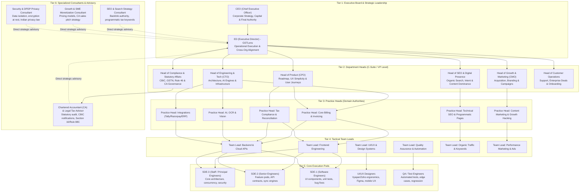

# 📖 GSTLENS — MASTER ARCHITECTURAL KNOWLEDGE BASE & CODEBASE COMPENDIUM
> **Single Source of Truth** for Developers, Tax Engineers, and AI Coding Assistants.  
> *Last Updated:* 2026-11-04  
> *Project Root Directory:* `D:\Projects\GST Software`

---

## 📑 TABLE OF CONTENTS
1. [Executive Summary & Core Mission](#1-executive-summary--core-mission)
2. [Dual-Repository Structure & Git Remotes](#2-dual-repository-structure--git-remotes)
3. [System Architecture Diagram](#3-system-architecture-diagram)
4. [Backend Engine (`Backend/`) Deep Dive](#4-backend-engine-backend-deep-dive)
   - [Directory Structure & Entry Points](#41-directory-structure--entry-points)
   - [AI Extraction Engine (Gemini 2.5 Flash)](#42-ai-extraction-engine-gemini-25-flash)
   - [Strict Statutory Date Normalization](#43-strict-statutory-date-normalization)
   - [Admin Portal API & 2FA Engine (`routes/admin.py`)](#44-admin-portal-api--2fa-engine-routesadminpy)
   - [GSTIN Verification & Master Lookup](#45-gstin-verification--master-lookup)
   - [Razorpay Webhook & Payment Engine](#46-razorpay-webhook--payment-engine)
   - [Cloud Synchronization Engine](#47-cloud-synchronization-engine)
   - [Backend Testing Suite](#48-backend-testing-suite)
5. [Frontend Application (`gstlens-frontend/`) Deep Dive](#5-frontend-application-gstlens-frontend-deep-dive)
   - [Directory Structure & Application Routes](#51-directory-structure--application-routes)
   - [Canonical Data Schemas](#52-canonical-data-schemas)
   - [Full GST Billing Engine (`lib/gstBillingEngine.ts`)](#53-full-gst-billing-engine-libgstbillingenginets)
   - [Offline-First Multi-Store IndexedDB (`lib/storage.ts`)](#54-offline-first-multi-store-indexeddb-libstoragets)
   - [Purchases OCR & Vendor Bill Ingestion (`app/(protected)/purchases`)](#55-purchases-ocr--vendor-bill-ingestion-appprotectedpurchases)
   - [GSTR Returns Suite (GSTR-1, GSTR-2B Reconciliation & GSTR-3B)](#56-gstr-returns-suite-gstr-1-gstr-2b-reconciliation--gstr-3b)
   - [Tally Prime XML Export Generator (`lib/tally.ts`)](#57-tally-prime-xml-export-generator-libtallyts)
   - [Batch Upload & Concurrency Queue (`lib/batchUpload.ts`)](#58-batch-upload--concurrency-queue-libbatchuploadts)
   - [Credits & Fintech Billing UI (`app/credits/page.tsx`)](#59-credits--fintech-billing-ui-appcreditspagetsx)
   - [Super Admin Dashboard (`app/admin`)](#510-super-admin-dashboard-appadmin)
   - [Progressive Web App (PWA), Service Worker & Offline UX](#511-progressive-web-app-pwa-service-worker--offline-ux)
   - [Frontend Testing Suite](#512-frontend-testing-suite)
6. [Statutory Indian GST Compliance Rules](#6-statutory-indian-gst-compliance-rules)
7. [Razorpay & Subscription Lifecycle State Machine](#7-razorpay--subscription-lifecycle-state-machine)
8. [Environment Variables & Configuration](#8-environment-variables--configuration)
9. [Operational Cheat Sheet (Commands & Execution)](#9-operational-cheat-sheet-commands--execution)
10. [Critical Bugs Encountered & Permanent Fixes](#10-critical-bugs-encountered--permanent-fixes)
11. [GSTLens Agentic Enterprise Organization Architecture](#11-gstlens-agentic-enterprise-organization-architecture)

---

## 1. Executive Summary & Core Mission
**GSTLens** is an all-in-one AI-powered GST invoice digitization, offline-first billing, statutory tax return filing, and accounting export platform designed specifically for Indian Small and Medium Businesses (SMBs), Tax Practitioners, and Chartered Accountants.

### Key Value Propositions:
1. **AI Vision Extraction**: Scans photographed, PDF, and printed B2B/B2C invoices using Google Gemini 2.5 Flash with deterministic structured schema parsing.
2. **Complete Invoicing & Document Suite**: Creates GST-compliant Tax Invoices, Proforma Invoices, Credit/Debit Notes, Delivery Challans, Bills of Supply, and Purchase Orders with automatic Indian currency word conversion, Section 170 round-off, and NPCI dynamic UPI QR codes.
3. **Automated Return Filing**: Generates 100% portal-compliant **GSTR-1** JSONs, auto-computes **GSTR-3B** liabilities/ITCs, supports **GSTR-2B vs Purchase Register 2A/2B Reconciliation**, and monitors **Rule 88C / DRC-01B** liability mismatch risks.
4. **Tally Prime & ERP 9 Interoperability**: Generates schema-compliant Tally XML vouchers with date range filters, granular invoice selection, ledger auto-balancing, and state mapping.
5. **Offline-First Hybrid Architecture**: Operates 100% offline via IndexedDB (`gstlens-db` v2, 8 object stores) and Service Worker, syncing seamlessly to Firebase Cloud Firestore for subscribed Pro users.
6. **Fintech Pricing Economics**: Transparent pay-as-you-go credit packs (₹1.43–₹2.00/invoice) + Pro recurring subscriptions (₹499/mo) with full RBI e-mandate protection.
7. **Enterprise Super Admin Suite**: 2FA-secured portal with custom subscription pitch override, credit modification, and platform-wide analytics.

---

## 2. Dual-Repository Structure & Git Remotes
The project is architected as two independent Git repositories located side-by-side:

| Directory | Role | Primary Remote URL | Branch |
| :--- | :--- | :--- | :--- |
| `D:\Projects\GST Software\Backend` | Python FastAPI Backend API | `https://github.com/ldhiman/GST-Lens-Backend.git` | `main` |
| `D:\Projects\GST Software\gstlens-frontend` | Next.js 16 Frontend Web App | `https://github.com/ldhiman/gstlens-frontend.git` | `master` |

> [!IMPORTANT]
> The root directory `D:\Projects\GST Software` is NOT a git repository. Never execute git commands in the root; always `cd` into either `Backend` or `gstlens-frontend`.

---

## 3. System Architecture Diagram

```
┌────────────────────────────────────────────────────────────────────────┐
│                        CLIENT / USER DEVICES                           │
│     Desktop Web Browser (Chrome/Edge/Firefox)  │  Mobile Web / PWA     │
└───────────────────────────────────┬────────────────────────────────────┘
                                    │
                                    ▼
┌────────────────────────────────────────────────────────────────────────┐
│                      FRONTEND: NEXT.JS 16 APP                          │
│  - Offline-First Storage: IndexedDB (`gstlens-db` v2, 8 Object Stores) │
│  - GST Billing Engine: Tax Invoices, Credit Notes, UPI QR, Discounts   │
│  - GSTR Returns Suite: GSTR-1, GSTR-2B Reconciler, GSTR-3B, DRC-01B   │
│  - Purchases OCR: Inward Vendor Bill Scanning, Duplicate Dedup         │
│  - Tally Prime XML Generator with Date Range & Invoice Checklist       │
│  - Batch Queue Worker Concurrency (4 workers, Rule 46(b) dedup)        │
│  - Super Admin Portal: TOTP 2FA, Custom Subscription Pitch, User Audit │
└───────────────────────┬──────────────────────────┬─────────────────────┘
                        │                          │
        Direct Firebase │                          │ REST API (Bearer JWT)
        Auth & Read     │                          │
                        ▼                          ▼
┌──────────────────────────────┐        ┌────────────────────────────────┐
│      FIREBASE PLATFORM       │        │     BACKEND: FASTAPI SERVER    │
│  - Firebase Auth             │        │  - Gemini 2.5 Flash Vision OCR │
│  - Cloud Firestore           │◄───────┤  - Strict Date Normalizer      │
│    - users/{uid}             │        │  - Admin API & TOTP Engine     │
│    - users/{uid}/invoices    │        │  - GSTIN Verification API      │
│    - payment_events          │        │  - Razorpay Webhooks & Sync    │
│    - admin_audit_logs        │        │  - Cloud Sync Guard (Expiry)   │
└──────────────────────────────┘        └──────────────┬─────────────────┘
                                                       │
                                  ┌────────────────────┴────────────────┐
                                  ▼                                     ▼
                      ┌──────────────────────┐              ┌──────────────────────┐
                      │   GOOGLE GEMINI AI   │              │   RAZORPAY GATEWAY   │
                      │  gemini-2.5-flash    │              │  Orders, Mandates,   │
                      │  Structured Schema   │              │  Subscriptions, V1   │
                      └──────────────────────┘              └──────────────────────┘
```

---

## 4. Backend Engine (`Backend/`) Deep Dive

### 4.1. Directory Structure & Entry Points
```
Backend/
├── app/
│   ├── core/
│   │   ├── config.py           # Pydantic Settings (.env configuration, Admin secrets)
│   │   └── razorpay_client.py  # Razorpay SDK initialization
│   ├── routes/
│   │   ├── admin.py            # Super Admin API, 2FA TOTP, custom plans & credit overrides
│   │   ├── payments.py         # Razorpay checkout, webhooks, cancellation & sync
│   │   ├── profile.py          # User profile settings & verified GSTIN registration
│   │   └── sync.py             # Incremental cloud synchronization for Pro users
│   ├── dependencies.py         # JWT Token verification, credit & subscription guards
│   ├── firebase.py             # Firebase Admin SDK & Firestore client initialization
│   ├── cv_preprocessor.py      # 5-Stage Computer Vision pre-processing pipeline (CLAHE, PyMuPDF, Unsharp Mask, EXIF)
│   ├── gst_info.py             # GSTIN master verification & state mapping
│   ├── image_process.py        # Gemini 2.5 Flash AI vision extraction engine
│   └── main.py                 # FastAPI application factory, CORS, /upload endpoint
├── tests/
│   ├── test_admin.py           # Super Admin authentication, TOTP & plan overrides
│   ├── test_gst_info.py        # GSTIN lookup & regex validation tests
│   ├── test_models.py          # Pydantic schema validation tests
│   ├── test_payments.py        # Razorpay idempotency, pricing & key collision tests
│   ├── test_preprocessor.py    # CV pipeline, PDF rasterization & safe fallback tests
│   └── test_validation.py      # AI post-validation & strict date parsing tests
├── requirements.txt            # Python dependencies
└── .env                        # Secret keys & credentials
```

### 4.2. AI Extraction Engine (Gemini 2.5 Flash) & Computer Vision Pre-Processor
- **Files:** [`Backend/app/image_process.py`](file:///D:/Projects/GST%20Software/Backend/app/image_process.py), [`Backend/app/cv_preprocessor.py`](file:///D:/Projects/GST%20Software/Backend/app/cv_preprocessor.py)
- **Model:** `gemini-2.5-flash` via `google-genai` SDK (`from google import genai`).
- **Configuration:** `temperature=0.0` (deterministic, zero hallucination).
- **5-Stage Computer Vision Pre-Processing Pipeline:**
  1. **300 DPI High-Res PDF Rasterization:** Renders vector PDF pages at 300 DPI using PyMuPDF (`fitz`), preventing pixelation on fine tables.
  2. **EXIF Auto-Orientation:** Corrects portrait/landscape rotation tags from mobile camera photos using `PIL.ImageOps.exif_transpose`.
  3. **Auto-Deskewing:** Detects dominant horizontal lines via Hough Transform / Canny edges and rectifies tilts within ±25°.
  4. **Adaptive Illumination Normalization (CLAHE):** Converts to LAB color space and equalizes the luminance (L) channel to eliminate shadows and illuminate faint thermal/kirana bills.
  5. **Text Edge Sharpening:** Applies selective Gaussian unsharp masking (`1.35 * original - 0.35 * blurred`) to disambiguate 15-char GSTIN characters (`8`/`B`, `0`/`O`).
  6. **Safe Non-Destructive Fallback:** Any parsing exception or non-standard format gracefully degrades to original bytes without throwing 500 errors.
- **CRITICAL GEMINI SCHEMA RULE:**
  > [!CAUTION]
  > Google Gemini's schema processor (`_transformers.process_schema`) strictly forbids static `default` values in Pydantic models. Using static defaults like `invoice_type: Literal["B2B", "B2C"] = "B2C"` triggers a fatal `ValueError: Default value is not supported in the response schema for the Gemini API`.
  > **Solution:** Use `Field(default_factory=lambda: "B2C")` and `@field_validator(..., mode="before")`.

### 4.3. Strict Statutory Date Normalization
- **File:** [`Backend/app/main.py`](file:///D:/Projects/GST%20Software/Backend/app/main.py#L32-L80)
- **Function:** `normalize_invoice_date(date_str: str) -> str`
- **Standard:** Normalizes all incoming invoice date representations into statutory **`DD-MM-YYYY`**:
  - ISO dates: `2026-10-24` $\to$ `24-10-2026`
  - Slash dates: `24/10/2026` or `24/10/26` $\to$ `24-10-2026`
  - Dot dates: `24.10.2026` $\to$ `24-10-2026`
  - Textual dates: `24-Oct-2026`, `24 October 2026` $\to$ `24-10-2026`
  - Validates day (1–31) and month (1–12). If unparseable, falls back to today's date in `DD-MM-YYYY`.

### 4.4. Admin Portal API & 2FA Engine (`routes/admin.py`)
- **File:** [`Backend/app/routes/admin.py`](file:///D:/Projects/GST%20Software/Backend/app/routes/admin.py)
- **Authentication:** Password + Time-based One-Time Password (TOTP via `pyotp`). Generates HS256 JWT tokens.
- **Key Capabilities:**
  - `POST /admin/login`: Verifies password and TOTP 6-digit code.
  - `GET /admin/users`: Paginated search across all registered users with subscription and credit status.
  - `POST /admin/users/{uid}/subscription/custom`: Allows sales/support teams to create custom pitch subscriptions (e.g., CA Enterprise Annual, 90-day trials, deal amounts, unlimited credits).
  - `POST /admin/users/{uid}/credits`: Instant credit increment or override with audit log notes.
  - `GET /admin/metrics`: Platform-wide summary of active users, paying subscribers, total invoices, and deal revenue.

### 4.5. GSTIN Verification & Master Lookup
- **File:** [`Backend/app/gst_info.py`](file:///D:/Projects/GST%20Software/Backend/app/gst_info.py)
- **Regex:** `^[0-9]{2}[A-Z]{5}[0-9]{4}[A-Z]{1}[1-9A-Z]{1}Z[0-9A-Z]{1}$`
- **State Codes:** Maps 2-digit GST state codes (`01` to `38`, `97` Other Territory, `99` Centre Jurisdiction) to official state names and vice versa.

### 4.6. Razorpay Webhook & Payment Engine
- **File:** [`Backend/app/routes/payments.py`](file:///D:/Projects/GST%20Software/Backend/app/routes/payments.py)
- **Credit Packs:** 50 credits = ₹100; 150 credits = ₹250; 350 credits = ₹500.
- **Pro Monthly Plan:** ₹499 / month (100 credits + continuous cloud sync).
- **Idempotency Architecture:** Uses Razorpay event ID (`event["id"]`) with scoped fallback `{event_type}_{sub_id}` to prevent cross-event collisions.
- **Lazy Expiration Guard:** [`app/dependencies.py`](file:///D:/Projects/GST%20Software/Backend/app/dependencies.py) automatically expires subscriptions if `now() > current_period_end + 24 hours`.
- **Live Reconciliation:** `POST /payments/sync-subscription` synchronizes state directly with Razorpay's API.

### 4.7. Cloud Synchronization Engine
- **File:** [`Backend/app/routes/sync.py`](file:///D:/Projects/GST%20Software/Backend/app/routes/sync.py)
- Incremental multi-device synchronization using `updated_at` server timestamps.
- Batch writes chunked into 400 operations (under Firestore's 500 operation limit). Protected by `subscription_required()`.

### 4.8. Backend Testing Suite
- **Directory:** `Backend/tests/`
- **Command:** `C:\Python312\python.exe -m pytest "D:\Projects\GST Software\Backend\tests"`
- **Total Tests:** 26 tests (100% passing across admin, gst_info, models, payments, validation).

---

## 5. Frontend Application (`gstlens-frontend/`) Deep Dive

### 5.1. Directory Structure & Application Routes
```
gstlens-frontend/
├── app/
│   ├── (auth)/
│   │   └── login/page.tsx            # Firebase phone/email authentication
│   ├── (protected)/
│   │   ├── clients/page.tsx          # Client & Vendor directory with GSTIN auto-fill
│   │   ├── dashboard/page.tsx        # Central invoice hub, metrics & batch upload
│   │   ├── expenses/page.tsx         # Expense tracker with category breakdown
│   │   ├── gstr-1/page.tsx           # GSTR-1 preparation & JSON download
│   │   ├── gstr-2b/page.tsx          # GSTR-2B JSON import & ITC reconciliation
│   │   ├── gstr-3b/page.tsx          # GSTR-3B tax computation & DRC-01B monitor
│   │   ├── inventory/page.tsx        # Product/Service catalog with HSN codes & stock
│   │   ├── invoices/                 # Sales Invoicing Suite (List, New, Edit [id])
│   │   ├── onboarding/page.tsx       # New business onboarding wizard
│   │   ├── purchases/page.tsx        # Inward purchase bills OCR & vendor register
│   │   ├── receipts/page.tsx         # Payment receipts & settlement records
│   │   ├── reconcile/page.tsx        # 2A/2B vs Purchase Register Reconciler
│   │   ├── recurring/page.tsx        # Automated recurring billing schedules
│   │   ├── reports/page.tsx          # Sales, purchases, tax & profit analytics
│   │   ├── returns/page.tsx          # Returns hub linking all GSTR modules
│   │   ├── settings/page.tsx         # Business profile, bank details & UPI QR setup
│   │   └── profile/page.tsx          # User profile & registered GSTIN
│   ├── admin/                        # Super Admin Portal (Login & Dashboard)
│   ├── credits/page.tsx              # Fintech billing, ROI estimator & subscriptions
│   ├── gst-info/page.tsx             # Public GSTIN search & verification tool
│   ├── privacy/page.tsx              # Privacy policy
│   ├── terms/page.tsx                # Terms of service
│   ├── layout.tsx                    # Root layout, theme, PWA prompt registration
│   └── page.tsx                      # Public landing page
├── components/
│   ├── AppSidebar.tsx                # Collapsible desktop/tablet navigation sidebar
│   ├── BatchUploadModal.tsx          # Multi-invoice batch upload progress modal
│   ├── BusinessOnboardingModal.tsx   # Fast GSTIN onboarding modal
│   ├── FilePreviewModal.tsx          # Invoice image inspection modal
│   ├── InstallPwaPrompt.tsx          # PWA "Add to Home Screen" Android/iOS banner
│   ├── InvoiceEditModal.tsx          # Invoice editor with StrictDateInput & fp sync
│   ├── InvoiceGenerator.tsx          # Full-featured GST invoice creator component
│   ├── InvoicePreview.tsx            # Printable/Exportable GST invoice view
│   ├── PeriodSelector.tsx            # Return period (MMYYYY) dropdown selector
│   ├── ServiceWorkerRegister.tsx     # Offline service worker registration
│   ├── TallyExportModal.tsx          # Tally Prime XML exporter (Date range & checklist)
│   ├── ThemeToggle.tsx               # Dark/Light mode toggle switch
│   └── header.tsx                    # Navigation bar & live cloud sync ticker
├── context/
│   └── AuthContext.tsx               # Firebase Auth state & userProfile subscription listener
├── lib/
│   ├── adminApi.ts                   # Super Admin API client
│   ├── api.ts                        # Authenticated fetch wrapper (`authFetch`)
│   ├── batchUpload.ts                # Concurrency queue (4 workers, duplicate check)
│   ├── compression.ts                # Client-side image compression (< 1MB)
│   ├── currency.ts                   # Indian Rupee formatter (`formatINR`)
│   ├── duplicates.ts                 # Statutory duplicate check (Rule 46(b))
│   ├── gstBillingEngine.ts           # Complete Indian GST billing & math engine
│   ├── gstr1.ts                      # Official GSTR-1 JSON schema compiler
│   ├── gstr3b.ts                     # GSTR-3B liability, ITC & CA CSV workpaper generator
│   ├── storage.ts                    # IndexedDB v2 multi-store wrapper (`gstlens-db`)
│   ├── sync.ts                       # Client-side background sync daemon
│   └── tally.ts                      # Tally Prime XML v1.0–4.1 statutory generator
├── public/
│   ├── sw.js                         # Offline cache service worker
│   └── offline.html                  # Offline fallback display
└── tests/                            # Node native test runner suite (48 tests)
```

### 5.2. Canonical Data Schemas
The application centers around canonical TypeScript representations:

#### Invoices (`CanonicalInvoice`):
```typescript
interface CanonicalInvoice {
  invoice_number: string;              // e.g. "INV-2026-001"
  invoice_date: string;                // Mandatory strict statutory format: "DD-MM-YYYY"
  seller_gstin: string;                // 15-character statutory GSTIN
  buyer_gstin?: string;                // 15-character statutory GSTIN (or empty for B2C)
  seller_gstin_info?: { legal_name?: string; trade_name?: string };
  buyer_gstin_info?: { legal_name?: string; trade_name?: string };
  invoice_type: "B2B" | "B2C";         // B2B if valid buyer GSTIN present; B2C otherwise
  pos: string;                         // 2-digit Place of Supply code (e.g. "07")
  taxable_value: number;               // Net taxable supply amount
  cgst: number;                        // Central GST amount
  sgst: number;                        // State GST amount
  igst: number;                        // Integrated GST amount
  cess?: number;                       // Statutory Compensation Cess
  invoice_total: number;               // Total invoice amount
  direction?: "outward" | "inward";    // Outward (Sales) vs Inward (Purchase)
  is_inward?: boolean;                 // Explicit purchase voucher flag
  is_rcm?: boolean;                    // Reverse Charge Mechanism flag (Section 9(3)/9(4))
  items?: Array<{
    description?: string;
    hsn_code?: string;
    quantity?: number;
    unit_price?: number;
    taxable_amount?: number;
    gst_rate?: number;
  }>;
}
```

### 5.3. Full GST Billing Engine (`lib/gstBillingEngine.ts`)
- **8 Document Types**:
  - `tax-invoice`: Tax Invoice (reduces stock, counts as sales)
  - `proforma`: Proforma Invoice (no tax liability, no stock change)
  - `credit-note`: Credit Note (increases stock, negative sales)
  - `debit-note`: Debit Note (reduces stock, additional sales)
  - `bill-of-supply`: For composition dealers or exempt supplies (zero tax)
  - `delivery-challan`: Goods in transit (no sales count)
  - `quotation`: Price estimate / quotation
  - `purchase-order`: Inward purchase order
- **Tax Calculation Capabilities**:
  - Pre-tax trade discount (Section 15(3)(a)) vs Post-tax cash discount.
  - Tax-Inclusive (MRP) reverse calculation: `taxable = (total * 100) / (100 + gst_rate)`.
  - Statutory Section 170 nearest-rupee rounding.
  - Indian currency to words generator (`numberToWords`).
  - Standard NPCI UPI QR string generator (`upi://pay?pa=...&am=...&cu=INR`).

### 5.4. Offline-First Multi-Store IndexedDB (`lib/storage.ts`)
- **Database:** `gstlens-db` (Version 2)
- **8 Distinct Object Stores**:
  1. `invoices`: AI scanned & generated sales invoices
  2. `clients`: Customer & vendor directory
  3. `inventory`: Products, services, stock quantities, and HSN codes
  4. `expenses`: Business expenses categorized by type
  5. `purchases`: Inward vendor bills and purchase register
  6. `receipts`: Payment receipts linked to invoices
  7. `recurring`: Scheduled recurring billing templates
  8. `settings`: Business profile, GSTIN, bank details, and invoice prefixes
- **Backup & Restore**: Generates complete multi-domain JSON backup files and safely restores them with ID conflict resolution.

### 5.5. Purchases OCR & Vendor Bill Ingestion (`app/(protected)/purchases`)
- Inward purchase bill scanning via Gemini 2.5 Flash with Computer Vision pre-processing.
- **Section 16(2) Duplicate Inward Detection**: Prevents accidental double ITC claims by flagging vendor bills with the same vendor GSTIN, invoice number, and financial year.
- **Vendor Auto-Mastering Engine ([`lib/vendorMaster.ts`](file:///D:/Projects/GST%20Software/gstlens-frontend/lib/vendorMaster.ts))**: Automatically matches extracted bills against IndexedDB `clients`. Auto-derives 10-digit PAN and state codes from 15-digit GSTINs, updates vendor contact details, and promotes client role (`customer` $\to$ `both`).
- Date bridge between statutory `DD-MM-YYYY` and HTML5 `<input type="date">` (`YYYY-MM-DD`).

### 5.6. GSTR Returns Suite (GSTR-1, GSTR-2B Reconciliation & GSTR-3B)
- **GSTR-1 (`lib/gstr1.ts`)**: Portal-compliant JSON export covering Table 4A/B/C/6B/6C (B2B), Table 5A/B (B2C Large), and Table 7 (B2C Small).
- **GSTR-2B Auto-Reconciliation Engine ([`lib/reconciliationEngine.ts`](file:///D:/Projects/GST%20Software/gstlens-frontend/lib/reconciliationEngine.ts), `app/(protected)/gstr-2b`)**:
  - **3-Tier Waterfall Matching:**
    - *Tier 1 (Exact Match):* Same GSTIN + same invoice number + value diff < ₹2.00.
    - *Tier 2 (Fuzzy Match):* Strips leading zeros and punctuation (e.g. `INV/2026/0045` vs `INV-2026-45`) with value diff < ₹5.00.
    - *Tier 3 (Amount Mismatch):* Same GSTIN and invoice number, but value diff $\ge$ ₹2.00.
  - **Rule 88C / DRC-01B High-Risk Detector:** Auto-computes ITC discrepancy between Books and GSTR-2B; alerts user if variance exceeds ₹25,000 or 10% to prevent automated demand notices.
  - **Section 16(4) Statutory Cut-off Monitor:** Enforces statutory deadline (30th November of subsequent FY); flags time-barred invoices with explicit ineligible badges.
  - **1-Click Vendor Mastering & Booking:** Automatically creates purchase bills and registers vendor profiles directly from GSTR-2B JSON.
- **GSTR-3B (`lib/gstr3b.ts`)**: Computes Table 3.1 outward liability, Table 3.2 inter-state B2C supplies, and Table 4 eligible ITC.
- **CA Workpaper Export**: Outputs a UTF-8 BOM CSV workpaper formatted for Excel analysis.

### 5.7. Tally Prime XML Export Generator (`lib/tally.ts`, `components/TallyExportModal.tsx`)
- Exports standard Tally Prime (v1.0–4.1+) and Tally.ERP 9 vouchers.
- **Multi-Document Support:**
  - **Sales Vouchers:** Debit Customer, Credit Sales & Output GST (CGST/SGST/IGST/Cess).
  - **Purchase Vouchers:** Credit Vendor, Debit Purchase & Input GST for ITC claim.
  - **Credit Notes:** Credit Customer, Debit Sales & Output GST with `<BILLTYPE>Agst Ref</BILLTYPE>`.
  - **Debit Notes:** Debit Vendor, Credit Purchase & Input GST with `<BILLTYPE>Agst Ref</BILLTYPE>`.
- **Configurable Ledger Mappings (`TallyLedgerConfig`):** Allows custom accounts (e.g. `Main Domestic Sales @ {rate}%`, `CGST Central Output A/c`, `Rounding Adjustment`).
- **Live XML Inspector & Preview:** Accountants can inspect exact XML syntax and copy to clipboard directly from the export modal.
- **Filtering**: Date range presets (`All`, `This Month`, `Last Month`, `This FY`, `Custom`) + Granular invoice checklist.
- **Accounting Double-Entry**: Ensures complete symmetry between party ledgers, sales/purchase accounts, tax ledgers, and Section 170 round-off.

### 5.8. Batch Upload & Concurrency Queue (`lib/batchUpload.ts`)
- Manages up to 4 concurrent upload workers.
- Detects in-batch duplicates before hitting the server.
- Supports retry of failed items without re-uploading succeeded invoices.

### 5.9. Credits & Fintech Billing UI (`app/credits/page.tsx`)
- **Radical Simplicity & Anti-AI Cliché System:** Stripped of neon gradient glows, fuel-gauge gimmicks, and cluttered ROI sliders in favor of a crisp, calm financial interface.
- **Account Balance Card:** High-contrast `text-4xl font-mono tabular-nums` balance indicator with subtle status badge (`Enterprise Unlimited`, `Pro Active`, or `Free Tier`).
- **Transparent Credit Packs:** 3 clean bordered cards (50 credits @ ₹100, 150 @ ₹250, 350 @ ₹500) showing exact unit cost per invoice and ITC eligibility.
- **Subscription Lifecycle:** Clearly displays renewal date, benefit matrix, cancellation grace banner, **Restart Subscription button** (`<RotateCcw />`), and queued upcoming custom subscription cards.
- **Statutory Trust Matrix:** Concise 4-card assurance grid covering RBI e-Mandate rules, 256-bit TLS encryption, Section 16 ITC eligibility, and 18% tax invoice generation.

### 5.10. Super Admin Dashboard & 2FA (`app/admin` & `app/admin/login`)
- **Clean 2FA Login (`app/admin/login`):** Centered neutral auth card with 6-digit monospaced TOTP entry and 1-click Authenticator QR setup.
- **Admin Central (`app/admin`):** High-contrast KPI row, debounced user search, segmented status filter pills, streamlined custom pitch deals modal with auto-upcoming queueing, and credit balance top-ups.

### 5.11. Progressive Web App (PWA), Service Worker & Offline UX
- **Service Worker (`public/sw.js`)**: Caches critical static assets and provides offline fallback (`public/offline.html`).
- **A2HS Prompt (`components/InstallPwaPrompt.tsx`)**: Guides Android and iOS Safari users through installing the app to their home screen.

### 5.12. Frontend Testing Suite
- **Directory:** `gstlens-frontend/tests/`
- **Command:** `npm test`
- **Total Tests:** 48 tests (100% passing across duplicates, fp, gstBillingEngine, gstr1, gstr3b, purchasesOcr, storage, tally).

### 5.13. "10-Year-Old Usability" & Human-First UX Architecture
- **Core Design Rule:** Any first-time user, shopkeeper, or child can access core actions in under 3 seconds without training.
- **Persistent Header Quick Actions (`header.tsx`):** Fixed `[📸 Scan Bill]` and `[➕ New Bill]` buttons always visible across all desktop and mobile screens.
- **6-Category Human Navigation (`AppSidebar.tsx`):** Replaced 14 bureaucratic menu items with 6 intuitive categories with quick sublink pills:
  1. 🏠 **Home** (`/dashboard` — Dashboard & quick overview)
  2. 🧾 **Sales & Bills** (`/invoices` — Make bills & record sales; pills: `+ New Bill`, `Receipts`)
  3. 📸 **Purchases & Scan** (`/purchases` — Scan bills with AI & track expenses; pill: `Expenses`)
  4. 👥 **Customers & Products** (`/clients` — Buyers, suppliers & stock; pill: `Inventory`)
  5. 📊 **GST Returns & Tax** (`/gstr-3b` — Check tax to pay 3B, 1, 2B; pills: `GSTR-1`, `GSTR-2B`)
  6. 💳 **AI Scans & Settings** (`/credits` — Recharge scans & business profile; pills: `Settings`, `Reports`)
- **The 1-Click Golden Rule Dashboard (`dashboard/page.tsx`):**
  - **4 Giant 1-Click Action Cards at Top:**
    1. 📸 **Scan a Bill with AI** (Instant file upload & camera snap)
    2. 🧾 **Create New Invoice** (Direct route to `/invoices/new`)
    3. 💰 **See Tax I Owe** (Direct route to `/gstr-3b` monthly tax summary)
    4. 📄 **My Invoices** (Direct route to `/invoices` master list)
  - **Plain-English Terminology:** Replaced technical jargon with clear words:
    - *Eligible ITC* $\to$ **Tax Discount on Purchases (ITC)**
    - *Inward Supplies* $\to$ **Total Purchases**
    - *Outward Supplies* $\to$ **Total Sales**
    - *Net Tax Payable* $\to$ **Net GST Tax to Pay**
  - **Visual 3-Step Guide:** `Upload Photo or PDF` $\to$ `AI Reads Bill (3 sec)` $\to$ `Ready in your account`.

---

## 6. Statutory Indian GST Compliance Rules

| Law / Section | Subject | System Implementation |
| :--- | :--- | :--- |
| **Rule 46(b)** | Invoice Number Uniqueness | Unique within a single Financial Year (01-Apr to 31-Mar). The same invoice number in a different FY is legally permitted and not treated as a duplicate. |
| **Section 12 / 13** | Place of Supply (POS) Destination Rule | If `pos === seller_state`: Intra-State supply $\to$ **CGST + SGST** (50% each).<br>If `pos !== seller_state`: Inter-State supply $\to$ **IGST** (100%). |
| **Section 15(3)(a)** | Trade Discount Deduction | Pre-tax discounts recorded on the invoice are deducted from the taxable supply value before tax computation. |
| **Section 16(2)** | ITC Claim Requirements | Inward purchase invoices must be validated against GSTR-2B before claiming ITC in GSTR-3B Table 4. Duplicate vendor bills are rejected. |
| **Section 170** | Rounding of Tax | Any fractional rupee in tax liability or ledger allocations must be rounded to the nearest whole rupee (0.50 and above rounded up, below 0.50 rounded down). |
| **Rule 88C / DRC-01B** | Discrepancy Monitoring | Triggers statutory alert if GSTR-1 outward tax liability exceeds GSTR-3B tax paid by more than ₹25,000 and 20%. |
| **Section 9(3) / 9(4)** | Reverse Charge Mechanism (RCM) | Flags RCM supplies where recipient is liable to pay tax directly. |

---

## 7. Razorpay & Subscription Lifecycle State Machine

1. **Creation**: User initiates plan $\to$ `POST /payments/create-subscription` $\to$ Razorpay creates subscription (`plan_id`, 12 months) $\to$ User authorizes bank/UPI e-mandate via Razorpay URL.
2. **Activation**: Razorpay sends `subscription.activated` webhook $\to$ Backend writes `subscription.active = True`, `current_period_end`, and enables cloud sync.
3. **Monthly Renewal**: Razorpay auto-debits bank $\to$ Sends `subscription.charged` webhook $\to$ Backend awards 100 credits and extends `current_period_end`.
4. **Cancellation**:
   - Via App: User clicks cancel $\to$ `POST /payments/cancel-subscription` $\to$ Backend calls Razorpay with `cancel_at_cycle_end=True`, sets `cancel_requested=True`.
   - Via Bank/UPI App: User revokes mandate $\to$ Next cycle charge fails $\to$ Razorpay sends `subscription.pending` (3 retries) $\to$ transitions to `subscription.halted`.
5. **Revocation & Automatic Promotion of Queued Plans (`upcoming_subscription`)**:
   - When an active plan is revoked (via Admin `DELETE /admin/users/{uid}/subscription` or Razorpay webhook `subscription.cancelled`):
   - If the user has an `upcoming_subscription` queued:
     - The queued plan is immediately promoted and activated as `subscription` (`status: "custom_active"`, `active: True`).
     - New validity period is calculated starting immediately: `current_period_end = now + (upcoming.duration_days * 86400)`.
     - The `upcoming_subscription` document map is removed via `firestore.DELETE_FIELD`.
     - `settings.cloud_sync_enabled` remains `True`, and root `unlimited_credits` matches the promoted deal.
   - If no upcoming plan exists, subscription is cancelled and cloud sync is disabled.
6. **Restart / Reactivation**: User clicks "Restart Subscription" $\to$ Backend initiates new subscription checkout to re-establish mandate.

---

## 8. Environment Variables & Configuration

### Backend: `Backend/.env`
```ini
# Google Gemini AI
GEMINI_API_KEY=AIzaSy...

# Razorpay Payment Gateway
RAZORPAY_KEY_ID=rzp_live_...
RAZORPAY_KEY_SECRET=...
RAZORPAY_WEBHOOK_SECRET=...
RAZORPAY_MONTHLY_PLAN_ID=plan_...

# Super Admin Portal 2FA & Credentials
ADMIN_PASSWORD=...
ADMIN_TOTP_SECRET=...
ADMIN_JWT_SECRET=...

# Firebase Admin SDK
FIREBASE_CREDENTIALS_PATH=app/firebase_creds.json

# Server Settings
ALLOWED_ORIGINS=http://localhost:3000,https://gstlens.vercel.app
ENVIRONMENT=production
```

### Frontend: `gstlens-frontend/.env.local`
```ini
NEXT_PUBLIC_API_URL=http://localhost:8000
NEXT_PUBLIC_FIREBASE_API_KEY=...
NEXT_PUBLIC_FIREBASE_AUTH_DOMAIN=...
NEXT_PUBLIC_FIREBASE_PROJECT_ID=...
NEXT_PUBLIC_FIREBASE_STORAGE_BUCKET=...
NEXT_PUBLIC_FIREBASE_MESSAGING_SENDER_ID=...
NEXT_PUBLIC_FIREBASE_APP_ID=...
NEXT_PUBLIC_RAZORPAY_KEY_ID=rzp_live_...
```

---

## 9. Operational Cheat Sheet (Commands & Execution)

### Running Backend Tests
```powershell
cd "D:\Projects\GST Software\Backend"
C:\Python312\python.exe -m pytest tests/
```

### Running Frontend Tests
```powershell
cd "D:\Projects\GST Software\gstlens-frontend"
npm test
```

### Building Frontend (Production Verification)
```powershell
cd "D:\Projects\GST Software\gstlens-frontend"
npm run build
```

### Starting Development Servers (When requested by user)
```powershell
# Backend (Port 8000):
cd "D:\Projects\GST Software\Backend"
C:\Python312\python.exe -m uvicorn app.main:app --host 0.0.0.0 --port 8000 --reload

# Frontend (Port 3000):
cd "D:\Projects\GST Software\gstlens-frontend"
npm run dev
```

---

## 10. Critical Bugs Encountered & Permanent Fixes

### 1. Gemini Schema Default Value Crash (500 Error on `POST /upload`)
* **Symptom:** `ValueError: Default value is not supported in the response schema for the Gemini API.`
* **Root Cause:** Pydantic models passed to `google-genai` structured outputs (`InvoiceData`) contained static default values (`invoice_type: Literal[...] = "B2C"`).
* **Permanent Fix:** Replaced with `Field(default_factory=lambda: "B2C")` and `@field_validator("invoice_type", mode="before")`.

### 2. Razorpay Webhook Cancellation Swallowed as Duplicate
* **Symptom:** Mandate cancelled in Dec 2025; credits stopped, but subscription remained stuck as `active: true`.
* **Root Cause:** `get_event_key()` returned `sub_id` for both `subscription.activated` and `subscription.cancelled`. The cancellation webhook was dropped by idempotency checks as a duplicate!
* **Permanent Fix:** Scoped event keys: `event.get("id")` (Razorpay event ID) or `{event_type}_{sub_id}`. Added expiration checks on `current_period_end` in `dependencies.py` and a `/payments/sync-subscription` endpoint.

### 3. Tally Prime XML Sales vs Purchase Voucher Inversion
* **Symptom:** Purchase invoices uploaded by a business were being exported as Sales Vouchers in Tally XML when testing with self GSTIN.
* **Root Cause:** GSTIN auto-detection logic was overriding explicit voucher direction tags.
* **Permanent Fix:** In [`lib/tally.ts`](file:///D:/Projects/GST%20Software/gstlens-frontend/lib/tally.ts), explicit `d.direction === "inward" || d.is_inward === true` strictly overrides auto-detection and applies opposite debit/credit rules.

### 4. Date Format Inconsistency
* **Symptom:** AI extraction and edit modals produced varying date formats (`2026-10-24`, `24/10/2026`, `24.10.2026`), causing return period `fp` miscalculations.
* **Permanent Fix:** Enforced statutory **`DD-MM-YYYY`** everywhere:
  - Backend: `normalize_invoice_date` in [`main.py`](file:///D:/Projects/GST%20Software/Backend/app/main.py).
  - Frontend: `StrictDateInput` with auto-masking in [`InvoiceEditModal.tsx`](file:///D:/Projects/GST%20Software/gstlens-frontend/components/InvoiceEditModal.tsx) and auto-sync to `fp` (`MMYYYY`) in [`storage.ts`](file:///D:/Projects/GST%20Software/gstlens-frontend/lib/storage.ts).

### 5. Invoice Print 3-Page Phantom Overflow & Statutory Rule 48 Copy Selection
* **Symptom:** Clicking "Print" on invoices produced 3 physical pages (Page 1 with the invoice, followed by trailing blank pages), and users lacked control over whether to print 1 customer copy or all 3 statutory transport copies.
* **Root Cause:**
  1. **CSS `visibility: hidden` Phantom Body Height:** Under `@media print`, `body * { visibility: hidden; }` concealed elements visually, but retained full DOM layout space. Background pages like `/invoices` with dozens of invoice rows calculated a 3,000px body height, forcing the browser's A4 print engine to spit out 3 pages.
  2. **Forced Min-Height Overflow:** Every template had `min-h-[1050px]` with `p-8 md:p-10`. Combined with browser margins, this exceeded standard A4 printable height (~1020px), spilling the footer onto subsequent pages.
  3. **GST Statutory Context (Rule 48 CGST Rules, 2017):** Invoices for goods legally require **Triplicate** issuance:
     - `Original for Recipient` (Rule 48(1)(a))
     - `Duplicate for Transporter` (Rule 48(1)(b))
     - `Triplicate for Supplier` (Rule 48(1)(c))
* **Permanent Fix:**
  - **Isolated Iframe Printing:** Implemented direct isolated iframe printing in [`InvoicePreview.tsx`](file:///D:/Projects/GST%20Software/gstlens-frontend/components/InvoicePreview.tsx) that copies active styles and prints strictly `#print-area`, completely cutting out the 3,000px background DOM tree and eliminating all blank trailing pages.
  - **Rule 48 Statutory Copy Selector:** Created [`lib/printRule48.ts`](file:///D:/Projects/GST%20Software/gstlens-frontend/lib/printRule48.ts) and added a toolbar selector allowing users to select `Original (Recipient) — 1 Page`, `Duplicate (Transporter) — 1 Page`, `Triplicate (Supplier) — 1 Page`, or `All 3 Copies (Rule 48 Triplicate) — 3 Pages`.
  - **Automatic Copy Watermark Badges:** Injected statutory Rule 48 citation badges across all 5 templates (`Modern`, `Classic`, `Minimalist`, `Compact`, `Thermal POS`).
  - **Height & Spacing Optimization:** Adjusted template min-heights to `min-h-[960px] print:min-h-0 print:h-auto print:p-4 print:shadow-none`, guaranteeing exact 1-page fit for standard bills.
  - **🌿 2-in-1 Eco-Saver Mode (Paper Loss Reduction):** Added `eco-dual` mode allowing businesses to print both *Original for Recipient* and *Duplicate for Supplier* on **1 single sheet of A4 paper** separated by a dotted cut line (`✂ Cut Along Line`), cutting paper consumption by **50%**.
  - **Empty Space Utilization:** Enriched Compact and Minimalist templates with Rule 46 HSN/SAC summary breakdowns, instant UPI dynamic QR codes, Ruled balance placeholder lines, and statutory terms to eliminate barren white voids and maximize paper utility.

---

## 11. GSTLens Agentic Enterprise Organization Architecture

GSTLens operates on a multi-tier, hierarchical autonomous agent architecture. Each level has strict mandates, cross-functional accountability, and deterministic escalation paths across Engineering, Product, Growth, Marketing, SEO, and Statutory Compliance.



### Detailed Tier Roles & Responsibilities

#### Tier 1: Executive Board & Strategic Leadership
- **1.1. Chief Executive Officer (CEO):** Sets corporate vision, capital allocation, high-level business goals, partnership alliances (banks, GST Suvidha Providers, CA associations), and holds final veto/approval authority.
  > [!CAUTION]
  > ### 🚨 STRICT FOUNDER / CEO GOVERNANCE MANDATE
  > **"Please take my approval before doing any major change"**
  > 
  > Under strict executive order from the Founder/CEO, all Tier 2 Department Heads, Practice Heads, Team Leads, and SDEs across Engineering, Product, Marketing, SEO, Compliance, and Operations must observe the following:
  > 1. **Explicit Prior Approval Required:** No major changes to code, architecture, UI layout, schema, pricing, or core workflows may be executed without explicit Founder/CEO approval.
  > 2. **Mandatory Proposal Protocol:** All technical, design, and growth recommendations must be structured as clear written proposals detailing:
  >    - **Proposed Change**
  >    - **Rationale & User Benefit**
  >    - **Scope & Impact**
  >    - **Formal Request for Approval**
  > 3. Zero unauthorized refactors or major PR merges are permitted under any circumstances.

- **1.2. Executive Director (ED) - GSTLens:** Day-to-day operational execution leader. Drives cross-departmental cadence, unblocks departmental dependencies, enforces SLAs, ensures the team remains fanatically focused on the user's core vision (Vyapar/Zoho simplicity, zero AI bloat).

#### Tier 2: Heads of Different Departments (C-Suite / VP Level)
- **2.1. Head of Engineering & Technology (CTO / VP Engineering):** Owns system stability, high-concurrency microservices, AI multimodal pipelines, cloud infrastructure, disaster recovery, and data isolation.
- **2.2. Head of Product (CPO / VP Product):** Champions the user experience. Enforces the "10-Year-Old Simplicity Rule", product discovery, user journeys, and feature roadmaps.
- **2.3. Head of Growth & Marketing (CMO):** Manages user acquisition funnels, digital performance marketing, referral programs, branding, and merchant outreach.
- **2.4. Head of SEO & Digital Presence:** Dominates organic search rankings for Indian GST billing, invoice generation, HSN code search, and tax return filing.
- **2.5. Head of Compliance & Statutory Affairs:** Governs adherence to CBIC, GSTN portal updates, CGST/SGST/IGST Acts, statutory formats, and audit readiness.
- **2.6. Head of Customer Operations & Success:** Directs merchant onboarding, priority support for CAs, custom enterprise deal conversions, and retention.

#### Tier 3: Practice Heads (Domain Authorities / Directors)
- **3.1. Practice Head: Core Billing & Invoicing:** Master authority on Indian invoicing rules (Rule 46(b)), multi-document formats (proforma, credit/debit notes, challans), HSN/SAC master tables, tax-inclusive MRP calculations, Section 170 round-off, and NPCI dynamic UPI QR code compliance.
- **3.2. Practice Head: AI, OCR & Computer Vision:** Directs Gemini 2.5 Flash vision prompts, OCR image pre-processing, adaptive bounding-box parsing, table extraction, and structured output schema resilience.
- **3.3. Practice Head: Tax Compliance & Reconciliation:** Directs official GSTR-1 JSON schema compilation, GSTR-2B vs 2A purchase register reconciliation, GSTR-3B liability/ITC auto-computation, and Rule 88C / DRC-01B warning systems.
- **3.4. Practice Head: Integrations & ERP Ecosystem:** Oversees Tally Prime XML v1.0–4.1 double-entry voucher generation, Razorpay payment orders/mandates, bank statement imports, and cloud backup sync.
- **3.5. Practice Head: Technical SEO & Programmatic Pages:** Directs programmatic SEO assets (Free Invoice Generator, GST Calculator, HSN Code Directory), Core Web Vitals, JSON-LD Schema (`SoftwareApplication`), and crawl budgets.
- **3.6. Practice Head: Content Marketing & Growth Hacking:** Owns educational guides for Indian SMBs, tax calendar alert campaigns, social proof, and CA practice toolkits.

#### Tier 4: Tactical Team Leads
- **4.1. Team Lead: Frontend Engineering:** Directs Next.js 16, React Server Components, Tailwind CSS styling, responsive desktop/mobile routing, and state stores.
- **4.2. Team Lead: Backend & Cloud APIs:** Directs FastAPI, Python 3.12, Pytest suites, JWT sessions, Firestore security rules, and worker background tasks.
- **4.3. Team Lead: Quality Assurance & Automation:** Owns end-to-end automation, calculation regression tests, browser compatibility, and CI/CD verification.
- **4.4. Team Lead: UI/UX & Design Systems:** Enforces Vyapar and Zoho Books visual simplicity, typography scales, tabular figures, and touch-first mobile ergonomics.
- **4.5. Team Lead: Organic Traffic & Keywords:** Manages high-intent keyword tracking, on-page optimization, meta tags, and internal link architecture.
- **4.6. Team Lead: Performance Marketing & Ads:** Manages Google Search Ads (high-intent billing queries), Meta Ads (traders and SMB owners), and campaign ROAS.

#### Tier 5: Core Execution Pods (Engineering, Design & QA)
- **5.1. SDE-3 (Principal / Staff Engineers):** Designs foundational architectures, database transaction locks, offline IndexedDB sync conflict engines, batch queue workers, and cryptographic security.
- **5.2. SDE-2 (Senior Engineers):** Implements core features, API routes, payment gateway webhooks, Firestore listeners, and business logic.
- **5.3. SDE-1 (Software Engineers):** Builds UI components, implements bug fixes, writes unit test suites, maintains date normalization, and verifies formatting.
- **5.4. UI/UX Designers:** Crafts clean desktop and mobile layouts inspired by Vyapar/Zoho, designs touch-first components, and eliminates visual clutter.
- **5.5. QA / Software Testers (Manual & Automation):** Executes exploratory tests, validates edge cases (e.g. leap years, GSTIN checksums, Section 170 edge round-offs), and tests mobile responsiveness.

#### Tier 6: Specialized Consultants & Advisory
- **6.1. Chartered Accountant (CA) & Legal Tax Advisor:** Continuously verifies statutory compliance with Indian GST laws, CBIC circulars, court rulings, and GSTN portal schema revisions.
- **6.2. SEO & Search Strategy Consultant:** Formulates domain authority growth strategies, high-quality backlink acquisition, competitor intelligence, and penalty avoidance.
- **6.3. Growth & SME Monetization Consultant:** Optimizes custom sales pitch pricing, conversion funnels for Indian business owners, and annual recurring retention.
- **6.4. Security, DevSecOps & DPDP Privacy Consultant:** Validates compliance with India's Digital Personal Data Protection (DPDP) Act 2023, data encryption at rest and in transit, and secret management.

---

*End of Knowledge Base. Keep this document updated with future architectural additions.*
